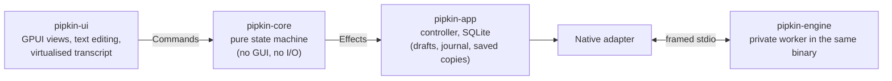

<div align="center">


# Pipkin

**A faster way to AI, for developers.**<br>
A native desktop coding agent with a built-in Rust engine and GPUI interface.


-080F1A?style=flat-square)


<br>


<sub>The window above is the built-in demo (a simulated agent, marked "Demo · simulated agent" in the app).</sub>

</div>

<br>

## Install in one line

On Linux x86_64 (Arch / Omarchy and other distributions), this is the simple way to get Pipkin:

```bash
curl -fsSL https://github.com/last-refuge/pipkin/releases/latest/download/install.sh | bash
```

It downloads the prebuilt archive of the latest release, checks it against the release's `SHA256SUMS`, and
installs it into `~/.local`. No root, no build, no external runtime. On Omarchy, press <kbd>Super</kbd>+<kbd>Space</kbd>
and type "Pipkin". Run the same line again to upgrade. Everything else, including macOS, installing by hand and
building from source, is under [Install](#install).

## Why Pipkin

Pipkin combines a built-in coding engine with a fast native interface: streaming answers,
tool calls you can read at a glance, a view of the project's working-tree changes, and a composer that saves drafts
with visible save status. It is a real application, not a web view: one Rust binary, GPU-drawn, with its own text
editing, selection and accessibility tree.

> **1.1.0.** Built and used daily on Arch / Omarchy (Hyprland, Wayland), which is the one supported platform.
> It runs a built-in Rust engine. macOS builds are experimental, and some of the accessibility and scaling
> checks that need a person at a machine are still open. See [Status](#status) and the
> [changelog](CHANGELOG.md) before you rely on it.

## Features

**Work with the agent**
- Streaming conversations with Markdown, syntax-highlighted code and one-click copy.
- Tool calls as quiet, slim lines: a plain verb ("Reading files", "Editing files", "Running"), what they act on, and a
  check, spinner or failure. A run of steps folds to one line ("Read 2 files, edited 1 file, ran 3 commands" plus the
  latest command) with a chevron at the end; click it to show every step and follow along live. The model's thinking is
  a one-line summary you can open. Expand any step for its full output, saved or copied in full even when long.
- **Steer** a run in progress, **queue** a follow-up, **stop** it, and pick it back up after a restart. The engine
  owns the queue, so what you see is what will run.
- Attach files by picker or by dropping them on the window; choose the model from the engine's catalog.
- Native subagents are included by default, with child status and transcript previews. Preferences → Allow
  subagents blocks new calls without cancelling ongoing work.
- Legacy profile extensions are outside Pipkin's scope. Historical extension metadata is preserved during import without
  loading extension code; see [compatibility](docs/extensions.md).

**See what changed**
- A changes pane with a diff card (line numbers, additions and removals) and a "Files changed" list with
  M / A / D badges and counts.
- Open the selected file in your editor, or a terminal in the project, from the pane.

**Keep work recoverable**
- Drafts are saved as you type; a send is journalled *before* dispatch and reconciled with the engine after a crash
  or lost connection. Uncertain outcomes are not blindly resent. This does not guarantee exactly-once external tool
  effects; see [recovery semantics](docs/support.md#quitting-and-interrupted-work).
- Conversations are cached on your machine: without the engine they still open, read and search, clearly marked as
  saved copies.
- Search messages across everything saved, and page back through history past a compaction.

**Feels native**
- A brand-true dark theme and a light one, Poppins throughout, text sizes, reduced motion, keyboard-first.
- Remembers your window size and pane widths. IME and accessibility integration exist, but native qualification
  is partial and typed-character screen-reader speech remains a failing/unverified gate; see [Status](#status).

<table>
  <tr>
    <td width="50%"></td>
    <td width="50%"></td>
  </tr>
  <tr>
    <td align="center"><sub>Tool calls at a glance</sub></td>
    <td align="center"><sub>Every change, with its diff</sub></td>
  </tr>
  <tr>
    <td></td>
    <td></td>
  </tr>
  <tr>
    <td align="center"><sub>Ready when you are</sub></td>
    <td align="center"><sub>Light theme</sub></td>
  </tr>
</table>

## Install

The one-line installer is the recommended way on Linux x86_64. The sections below cover what it does, installing
by hand, macOS, building from source and managing an installed Pipkin.

### The one-line installer (Linux x86_64)

```bash
curl -fsSL https://github.com/last-refuge/pipkin/releases/latest/download/install.sh | bash
```

The script downloads the prebuilt archive named in the latest release's `SHA256SUMS`, verifies the checksum,
unpacks it and runs the archive's own installer into `~/.local`. It never compiles anything: on a Mac, another
architecture or a release without a Linux archive it stops and says what to do instead. It needs `curl`, `tar`,
`zstd` and `sha256sum`, asks for no password and sends no credentials. The script is short and lives
[in this repository](install.sh); read it first if you like, or run it with `--dry-run`.

| Option | Effect |
| --- | --- |
| `--version 1.1.0` | install that release instead of the latest |
| `--prefix DIR` | install somewhere other than `~/.local` |
| `--dry-run` | show what would happen and change nothing |
| `--list` | list the installed versions |
| `--rollback` | reactivate the previous version in one step |
| `--uninstall` | remove Pipkin; your data in `~/.local/share/pipkin` stays |

Pass options after `bash -s --`, for example:

```bash
curl -fsSL https://github.com/last-refuge/pipkin/releases/latest/download/install.sh | bash -s -- --dry-run
```

The supported platform is **x86_64 Arch/Omarchy, Hyprland/Wayland** with a Vulkan-capable GPU driver. Other
desktops, distributions and X11 are experimental, and native ABI compatibility follows the release's build inputs.
The installed package is the app and engine in one Rust binary; it keeps versioned binaries, performs an offline
engine handshake before activating a version, and preserves application data across upgrades and rollbacks.
Releases are checksummed but not signed. Database rollback needs compatible schemas or the documented backup
restoration; see [packaging](docs/packaging.md).

### By hand

Release archives are on [GitHub Releases](https://github.com/last-refuge/pipkin/releases): the Linux x86_64
archive with its installer, the experimental macOS DMG/ZIP for Apple Silicon and Intel, `build-info-*.json`,
`install.sh` and one `SHA256SUMS`. Check the checksum before installing.

```sh
sha256sum --check --ignore-missing SHA256SUMS
tar --zstd -xf pipkin-native-<version>-x86_64.tar.zst && ./install.sh     # Linux: into ~/.local, no root needed
```

For a pacman-managed Arch package instead of the per-user installer, see the advanced instructions in
[getting started](docs/getting-started.md).

### macOS (experimental)

Download the DMG for your Mac, open it and drag Pipkin to Applications. The app is ad-hoc signed and not
notarized, so Gatekeeper warns on first launch, and no interactive acceptance has been run on a Mac.
See [macOS notes](docs/macos-first-pass.md).

### Build and use it from source (Mac or Linux)

Install your platform's [native build prerequisites](docs/source-setup.md#1-install-native-build-prerequisites-once)
once, then:

```sh
git clone https://github.com/last-refuge/pipkin.git && cd pipkin
scripts/setup.sh --run       # build the native app/engine, check, launch
```

**No external engine checkout, patches, npm install or server startup. Subagents are included by default.**
The launcher selects this checkout as the project so you can use Pipkin to build Pipkin.

```sh
scripts/run.sh              # run the last successful native build again
scripts/setup.sh --install  # install for your user: Linux ~/.local; Mac ~/Applications/Pipkin.app
scripts/setup.sh --check    # check prerequisites only; no downloads or installation
```

Mac source builds support Apple Silicon/Intel. Linux source setup targets glibc x86_64 (Arch/Omarchy,
Debian/Ubuntu/Fedora prerequisites are documented; other desktops remain experimental). The script never
runs sudo or installs Node/npm. Each rebuild stages an immutable native binary, so you can
build while the old app runs; **Quit and relaunch to use the new build**. See the
[complete source setup and self-development guide](docs/source-setup.md).

### Advanced external engine

Native credentials and configuration live separately from legacy profiles; `--pi-agent-dir DIR` selects an import source.
The built-in engine supports explicitly managed native hosts; see [native attachment](docs/native-attachment.md).
Legacy `--pi-repo`, `--pi-dir`, `--pi-server-id` and `--pi-extension` flags are retired.

Provider setup, missing/expired credentials and model refresh are documented in
[getting started](docs/getting-started.md). Data ownership, quitting, uncertain work and diagnostic privacy are in
[support and recovery](docs/support.md). Review diagnostic output before sharing it: engine logs may contain secrets.
For sensitive security concerns, use the [private vulnerability-report route and security policy](SECURITY.md),
not a public bug report.

## Using it

| You want to | Run |
| --- | --- |
| Talk to a real model | `scripts/run.sh` (source build), or `pipkin` / the installed Mac app; configure the provider in Pipkin |
| Verify installed coding without live accounts | `scripts/test-native-package.sh` (isolated scripted provider, real tools, migration and restart) |
| Look around with fake data | `pipkin --demo normal` (also: `followup`, `failure`, `unknown`, `stressed`, `large`, `persist-fail`) |
| Check an installation | `pipkin --version`, `pipkin --diagnose [--probe]` |
| Open a specific project | `--project DIR` (repeatable; the last one is selected) |
| Use your own editor / terminal | `--editor CMD`, `--terminal CMD` (else `$VISUAL`/`$EDITOR`, `$TERMINAL`) |
| Keep data elsewhere | `--data-dir DIR` |

### Continuous goals

Type `/goal <what to accomplish>` in the composer and press Enter. While Pipkin is open, it keeps the goal attached to that conversation and asks the engine to continue after each completed turn until the engine explicitly reports it met, blocked, or unreachable. `/goal <new goal>` replaces it; `/goal clear` removes it and stops an active goal turn. The goal strip above the composer shows its status and has a clear button.

If the engine does not give an unambiguous status, or a turn fails, Pipkin pauses instead of blindly continuing. Saved goals return paused after a restart so an uncertain turn is never resent automatically; re-enter `/goal <goal>` to resume. In demo mode, replies are simulated and do not execute the goal.

### Session usage

Type `/session` in the composer, use **Session usage** in the command palette, or click **Usage** beside the composer to inspect the selected session. Pipkin reads the committed usage ledger and shows input/output/cache tokens, total tokens, reported cost, and a model/tool breakdown. The figures are the engine's estimates, not a provider billing balance. Demo mode reports no real usage.

The engine currently does not expose provider account quota, remaining balance, or reset times to Pipkin. Check your provider dashboard for account limits.

### Keyboard

| | | | |
| --- | --- | --- | --- |
| `Ctrl K` command palette | `Ctrl N` new chat | `Ctrl L` focus composer | `Ctrl J` focus transcript |
| `Enter` send | `Shift Enter` new line | `Ctrl Enter` queue follow-up | `Ctrl Shift Enter` steer the run |
| `Ctrl .` stop the run | `Ctrl M` choose model | `Ctrl O` attach files | `Ctrl Down` jump to latest |
| `Ctrl B` sidebar | `Ctrl I` changes pane | `Alt Up/Down` previous / next chat | `F2` rename demo chat |
| `Ctrl ,` settings | `Ctrl Shift O` open project | `Esc` close a menu | `Ctrl Q` quit |

Real-mode conversation names are derived from prompts. The pinned engine has no rename operation: the palette
entry is disabled and F2 explains the limitation, rather than claiming a local title is engine-confirmed.

## How it works



- **`pipkin-core`** holds every decision (run state, queues, availability, draft and save state) and knows nothing
  about the GUI. Every event from the engine carries `(conversation, generation, operation)` and stale ones are
  dropped.
- **`pipkin-ui`** only renders and turns input into commands. Rendering does no I/O and no parsing.
- **`pipkin-app`** owns the database, the launched engine's lifecycle and the glue. It starts/restarts the engine it
  owns and stops it when you quit. A separately started external server can continue work; see
  [quitting and interrupted work](docs/support.md#quitting-and-interrupted-work).
- **`pipkin-engine`** runs providers, coding tools, durable sessions and queues; **`pipkin-engine-protocol`** defines its versioned desktop boundary.

## Status

| Milestone | State |
| --- | --- |
| Real read path, first real workflow, daily-use execution and recovery | Built, tested against a real engine |
| Complete local product (history, search, tool output, offline cache) | Built; native gates partly run |
| Distributable alpha (bundled engine, package, diagnostics, upgrade / rollback) | Built; checked in a scratch prefix, not on a clean machine |
| 1.0.0 and 1.1.0 releases (Linux archive, experimental macOS builds, checksums) | Published; nothing but Arch / Omarchy is supported, and releases are not signed |

**Not done or not verified yet:** a screen reader does not yet speak typed characters in the composer; input methods
are verified with one engine; 150% scale, minimize / suspend / resume, a clean `pacman -U` install and a long soak are
for a person to run; macOS has experimental native builds but Windows remains deferred; there is no in-app update channel. The
owner-run checks are written up in [`docs/native-gate-testing.md`](docs/native-gate-testing.md) and the full plan, with
what each milestone really covers, is in [`docs/rust-desktop-client-plan.md`](docs/rust-desktop-client-plan.md).

| Platform | Support |
| --- | --- |
| Arch / Omarchy, Wayland (Hyprland) | **Supported (1.0.0)** |
| X11 / Xwayland | Builds and starts; seen under Xwayland only |
| GNOME, KDE, other distributions | Unverified |
| macOS Apple Silicon / Intel | Experimental release builds (ad-hoc signed, not notarized); engine tests still intermittent on the macOS CI runners; interactive acceptance partial |
| Windows | Deferred ([platform status](docs/platforms.md)) |

## Developing

```sh
cargo test --workspace && cargo clippy --workspace --all-targets && cargo fmt --all --check

# Build and verify installed migration, coding tools and restart without live accounts
scripts/test-native-package.sh

```

```
crates/pipkin-core   state machine, protocol of commands/effects (no GUI)
crates/pipkin-ui     GPUI views, theme tokens, text editor, transcript
crates/pipkin-app    controller, storage, engine lifecycle, install and diagnostics
crates/pipkin-engine native engine, providers, tools and durable store
crates/pipkin-engine-protocol versioned messages and transports
packaging/ scripts/  Arch package, installer, release and verification scripts
assets/              fonts, icons and the mascot, with provenance
docs/                the plan, architecture, packaging, platforms, beta and gate notes
```

Useful reading: [`docs/architecture.md`](docs/architecture.md), [`docs/packaging.md`](docs/packaging.md),
[`docs/platforms.md`](docs/platforms.md), [`docs/beta.md`](docs/beta.md), [`docs/extensions.md`](docs/extensions.md),
[`docs/scorecard.md`](docs/scorecard.md). The built-in engine conversion is tracked in
[`llm-docs/pipkin-rust-engine-plan.md`](llm-docs/pipkin-rust-engine-plan.md); the built-in engine is now the default.
`AGENTS.md` lists the project's non-negotiables, including the safe way to
drive the real window in native tests (`scripts/guard.sh`).

## Credits

Pipkin is built on [GPUI](https://github.com/zed-industries/zed) (from the Zed project; Zed's GPL crates are read for
reference, never copied) and includes MIT-licensed behavior ports from [Pi](https://github.com/jasona/pi), with notices retained. Typeface: [Poppins](https://github.com/itfoundry/Poppins)
(SIL OFL) for the interface, [Lilex](https://github.com/mishamyrt/Lilex) (SIL OFL) for code, IBM Plex Sans Italic (SIL OFL)
for emphasis. Icons: [Lucide](https://lucide.dev) (ISC). The mascot and wordmark are Pipkin's brand artwork. Full
provenance is in [`assets/PROVENANCE.md`](assets/PROVENANCE.md).

## License

Pipkin is released under the [MIT License](LICENSE). The bundled fonts, icons and mascot keep their own terms, listed in
[`assets/PROVENANCE.md`](assets/PROVENANCE.md): Poppins, Lilex and IBM Plex Sans are SIL OFL 1.1, the icons are ISC, and the
mascot and wordmark are Pipkin's brand artwork, used as approved. No Pi engine is bundled: the built-in engine ports behavior
from Pi, and the notices for the ported Pi, Anthropic, minimatch and brace-expansion sources are kept in
[`packaging/upstream-notices.json`](packaging/upstream-notices.json) and shipped in every archive's license inventory.
